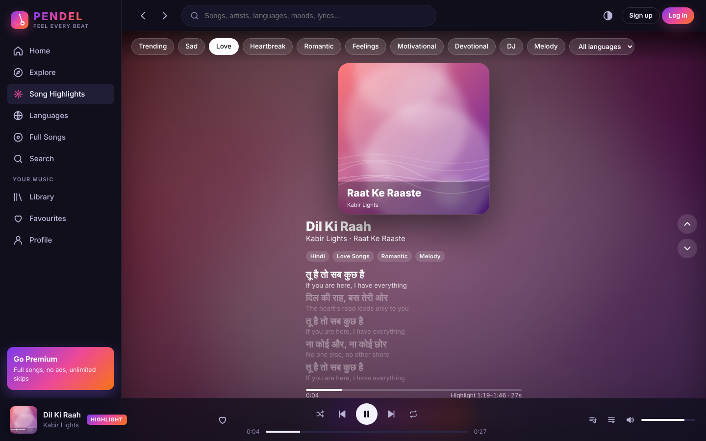
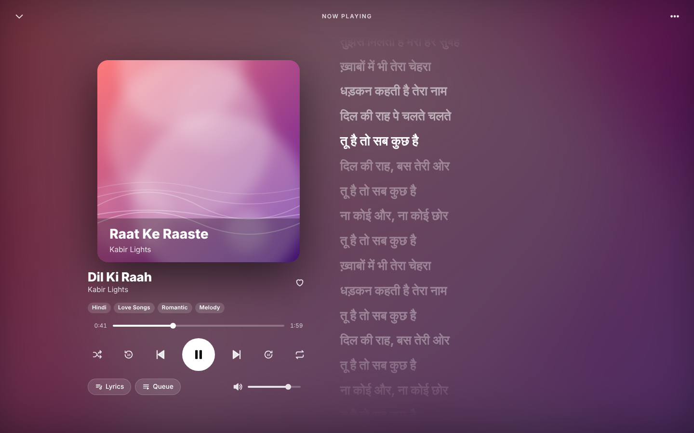
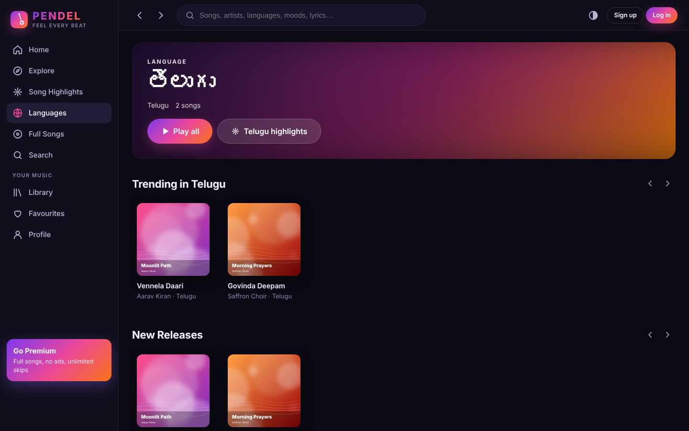
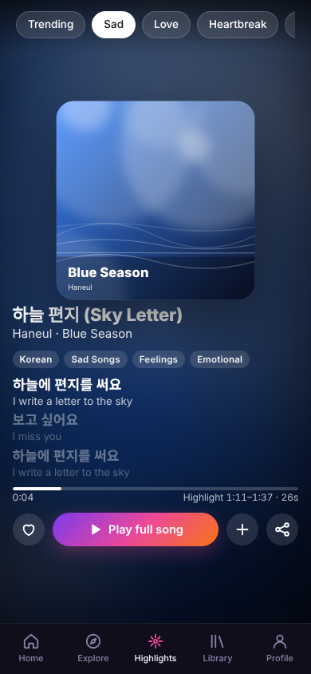

# PENDEL

### Feel Every Beat.

**🔗 Live demo: [pendel.onrender.com](https://pendel.onrender.com)**
*(free hosting — the first visit can take up to a minute to wake the server)*

Demo login: `demo@pendel.local` / `Demo@12345`

PENDEL is a full-stack, multilingual music streaming platform built around one idea: every song has a 20–30 second moment that makes people fall in love with it. Listeners swipe through those **Song Highlights** by mood and language, then tap **Play full song** to hear the complete licensed track.


## Screenshots

| Song Highlights (swipe feed) | Full player with synced lyrics |
|---|---|
|  |  |
| **Language-wise library** | **Mobile** |
|  |  |

**Admin waveform highlight editor:** drag a 20–30 s window over the chorus, auto-detect it from the audio, preview and save.


## Highlights of the project

- **20–30 s Song Highlights:** a vertical swipe feed with 10 mood feeds, synced lyric lines and translations, auto-advance, and one tap to the full song.
- **Automatic chorus detection:** scores audio windows by loudness and repetition (NumPy + FFmpeg). It finds the chorus in 35 of 39 demo songs.
- **24 languages** in the demo catalogue (Telugu, Tamil, Hindi, Kannada, Malayalam, Bengali, Punjabi, English, Spanish, Korean, Japanese, Arabic and more), with native-script lyrics.
- **Complete player:** queue, shuffle, repeat, seek, mini and full-screen modes, lock-screen controls, synced lyrics with click-to-seek.
- **Accounts and library:** email/Google login, favourites, playlists (drag to reorder, share, follow), auto playlists and listening history.
- **Recommendations:** content-based "Made For You" mixes and a mood picker.
- **Free and Premium plans:** skip limits, house ads and Premium-only tracks, with a UPI/card payment architecture (Razorpay-ready, test mode by default).
- **Admin dashboard:** role-based access, analytics, song and licence management, bulk CSV import, lyrics editor, copyright takedowns and an audit log.
- **Security:** PBKDF2 password hashing, signed bearer tokens, expiring HMAC-signed audio URLs, a strict Content Security Policy and rate limiting.
- **Tested:** 17 automated API tests and a Playwright browser walkthrough.

**Tech stack:** Python 3.10+ (standard library HTTP server, no frameworks) · SQLite · vanilla JavaScript ES modules · HTML/CSS · NumPy · FFmpeg · deployed on Render.

All 39 demo songs, covers and lyrics are original works generated by code and released as CC0. No copyrighted music is included.

---

## Run it (Windows PowerShell)

```powershell
cd PENDEL
python --version          # needs 3.10 or newer
python -m server.app
```

Open **http://localhost:8000**.

| Account | Email | Password |
|---|---|---|
| Listener | `demo@pendel.local` | `Demo@12345` |
| Super admin | `admin@pendel.local` | `Admin@12345` (change it after first login) |

> Upgrading from the earlier "Refrain" build? Your existing `data/refrain.db` is picked up automatically, and its accounts keep their old `@refrain.local` emails. Delete `data/` to reseed with the PENDEL demo accounts.

The database is created in `data/` on first start and seeded with the demo catalogue. To start fresh, stop the server and delete the folder with `Remove-Item -Recurse -Force data`.

To change settings, run `Copy-Item .env.example .env` and edit `.env` (port, admin account, storage, Google sign-in, payments).

**Optional:** install [ffmpeg](https://www.gyan.dev/ffmpeg/builds/) and run `pip install numpy`. With both installed, the server automatically detects the best highlight in uploaded songs and cuts a separate preview file for each one. Without them, everything still works: admins set highlights by hand, and the player plays that time window from the full file.

On macOS or Linux the commands are the same; use `python3`.

## Tests

```powershell
python -m unittest tests.test_api -v      # 17 API tests on a throwaway database
```

`tests/e2e_browser.py` is a Playwright browser walkthrough. It needs `pip install playwright` and the server running; set `BASE` to the server's URL.

---

## Feature map

| Area | Where |
|---|---|
| Home: Trending, Most Popular, Recently Released, Top 20, Recommended (with a mood picker), Made For You mixes, and 19 mood/category rails | `/` |
| **Song Highlights**: vertical swipe feed (scroll-snap, arrow keys, ▲▼ buttons), 10 feeds (Trending, Sad, Love, Heartbreak, Devotional, DJ, Melody, Motivation, Romantic, Feelings), language filter, synced lyric lines with translation, progress bar, auto-advance, favourite, add to playlist, share, **Play full song** (opens the full-screen player) | `/highlights/<feed>` |
| Languages: 12 Indian and 14 international languages plus "discover more" (14 extra); each language page has trending, new releases, sad, love, devotional, DJ, artists, albums and complete songs | `/languages`, `/language/te` |
| Full Songs: search, language, mood, genre, year range, has-lyrics and free-to-stream filters; six sort orders; pagination | `/songs` |
| Player: play/pause, next/previous, ±10 s, seek, volume and mute, shuffle, repeat (all/one), queue drawer (reorder, remove, play next), mini-player, full-screen player, lock-screen and headset controls (Media Session), keyboard shortcuts, keeps playing across pages | everywhere |
| Lyrics: licensed lyrics only, synced highlighting, auto-scroll (pauses when the listener scrolls), tap a line to seek, translations, expandable drawer, any Unicode script with `dir="auto"` | 🎤 button |
| Search: songs, artists, albums, languages (by English or native name), moods, genres, and licensed lyric lines; live autocomplete with keyboard navigation | top bar, `/search` |
| Accounts: email sign-up and login, Google Sign-In (once configured), avatar upload, preferred languages and moods, theme, change password, log out of all devices | `/profile` |
| Library: playlists, auto playlists (My Sad Songs, My Love Songs, My Favourite Devotional Songs, My DJ Collection, My Trending Songs), favourites, recently played, listening history | `/library` |
| Playlists: create, edit, delete, add/remove songs, drag-and-drop or ▲▼ reordering, public/private, share link, follow | `/playlist/<id>` |
| Subscriptions: Free (house ads every N songs, skip limit, previews of Premium-only songs) and Premium (full streams, no ads, unlimited skips, high-quality assets when uploaded) | `/premium` |
| Admin: role-based (super admin, content manager, moderator, analyst); analytics including highlight→full-song conversion; song CRUD with mandatory licensing; audio and cover upload; **waveform highlight editor** (drag a 20–30 s window, auto-detect, preview, save); LRC lyrics and translations; bulk upload with CSV import and dry run; artists, albums, categories, languages, users, roles, Premium grants, playlists, plans and free-tier rules; copyright takedown/restore log; audit log | `/admin` |
| SEO: server-rendered `<title>`, meta description, Open Graph tags and JSON-LD (`MusicRecording`/`MusicGroup`) on song, artist, language and category URLs; `sitemap.xml`, `robots.txt` | |

## How highlights work

1. Every song has one row in `song_highlights` (`start_sec`, `end_sec`), connected to the song by `song_id`. A database `CHECK` constraint enforces a length of 20–30 seconds.
2. When an admin uploads audio, `server/highlights.py` decodes it and scores every 25-second window on **loudness/density** and **repetition** (how closely it matches another part of the song, which is the signature of a chorus). The first 15 seconds are penalised, so a highlight never defaults to the intro. On the demo catalogue it lands on a chorus in 35 of 39 songs.
3. The suggestion is saved as `source=auto`. Admins can drag the window in the waveform editor, and their choice is saved as `manual`, which a later re-upload never overwrites.
4. ffmpeg cuts a separate **preview asset** with short fades. The highlight feed streams only that file, so free listeners never receive the full track for Premium-only songs.

## Licensing safeguards built in

- A song cannot be created without a licensing record (licensor, type, territories, dates, reference) and cannot be published without audio.
- Licence flags control **free full streaming**, **offline downloads** and **lyrics display**. Lyrics can only be added to a song when the licence allows them.
- Audio is only served through signed URLs that expire.
- **Takedown** removes a song from every listing, feed and search result and returns HTTP 451 for streams. It keeps a legal record of the claimant and reason, and can be reversed.
- Every admin action is written to the audit log.

## Going to production

| Concern | What to do |
|---|---|
| Real catalogue | Upload licensed audio in the admin dashboard, or bulk-upload files and import a CSV. Set `SEED_DEMO=false` (and delete `data/`) to start without the demo songs. |
| Cloud audio + CDN | Set `STORAGE_DRIVER=s3` and the `S3_*` variables, then run `python tools/sync_media_to_s3.py` once. Put CloudFront or Cloudflare in front of the bucket and set `CDN_BASE_URL`. If the bucket is on another domain, enable CORS for GET from your site so the admin waveform can load. |
| Payments | Set `PAYMENT_PROVIDERS=razorpay` with `RAZORPAY_KEY_ID`/`RAZORPAY_KEY_SECRET` (supports UPI, cards, netbanking and wallets). Point the Razorpay webhook to `/api/webhooks/razorpay` and set `RAZORPAY_WEBHOOK_SECRET`. **Remove `sandbox`.** Other gateways (Stripe, PayPal, Paytm) plug in through `server/payments.py`. |
| Google login | Set `GOOGLE_CLIENT_ID`. The button appears automatically, and ID tokens are verified on the server. |
| HTTPS & scale | Run behind Nginx or Caddy with TLS, and set `PUBLIC_URL`. For millions of users, see `docs/ARCHITECTURE.md`: PostgreSQL, Redis, workers, OpenSearch and an audio CDN. |

## Project layout

```
server/      app.py (HTTP server, router, 100 API endpoints), db.py (schema + seed), security.py,
             storage.py (local/S3), highlights.py (detection + preview cutting), recommend.py, payments.py, config.py
web/         index.html, css/app.css, js/{app,api,ui,player,lyrics,views,highlights,admin}.js, img/ (logo, icons)
media/       demo audio (full + preview), album covers, artist images
tools/       generate_demo_music.py (re-creates the CC0 demo catalogue; needs numpy + ffmpeg), catalog_data.py, sync_media_to_s3.py
tests/       test_api.py, e2e_browser.py
docs/        ARCHITECTURE.md
```
